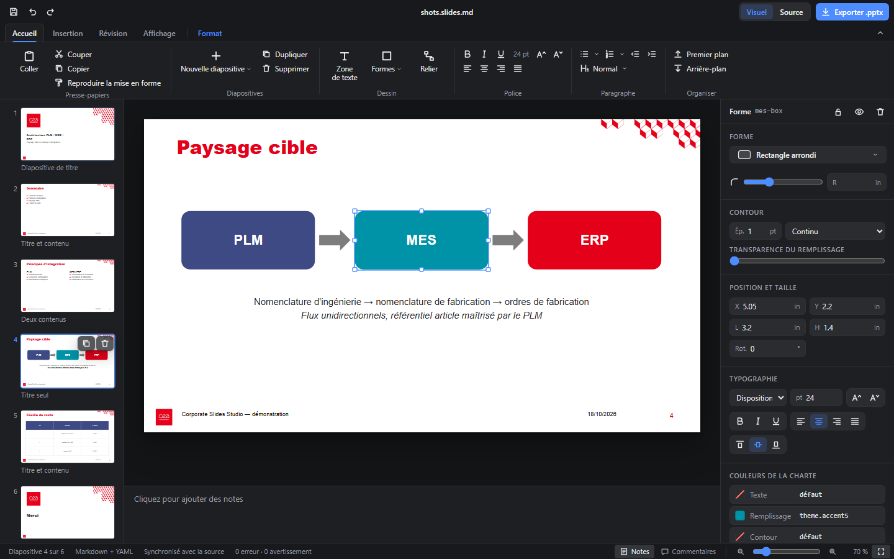

# Corporate Slides Studio

Environnement « PowerPoint as code » pour VS Code : importez un gabarit PowerPoint corporate, écrivez vos présentations en **Markdown** ou en **DSL YAML**, éditez-les dans un **éditeur visuel WYSIWYG** dont chaque modification est réécrite dans la source, validez la charte et exportez un **.pptx natif et éditable**.

Un modèle canonique (`SlideDocument`), deux formats source, un éditeur visuel, un générateur déterministe (`pptxgenjs-plus`). Tout reste local.



## Prérequis

- Node.js ≥ 22 (vérifié avec 24.13.0), pnpm 11
- VS Code ≥ 1.109
- Facultatif : PowerPoint (Windows) ou LibreOffice pour le rendu de référence et les vignettes

## Installation

Slides Studio est livré **dans l'extension Graph Model Studio** (`vscode-extension/`) : un seul `.vsix`, activé par `integrations/host.js`, qui partage l'éditeur et le rendu des diagrammes `.gmc`. Ce dossier est un espace de travail pnpm autonome (React 19, zod 4, Vite 8) dont les bundles sont écrits dans `vscode-extension/dist/slides-studio/`.

```bash
pnpm install
pnpm build          # CLI (packages/cli/dist/cli.cjs) + extension → ../dist/slides-studio/
# depuis vscode-extension/ : pnpm run build:slides-studio (fait partie de build:source / package)
```

Pour développer : `pnpm build` ici, puis *Run Extension* (F5) avec `vscode-extension/` comme chemin de développement, ou :

```bash
code --extensionDevelopmentPath=.. .
```

## Parcours utilisateur (VS Code)

1. **Importer le gabarit** — palette : `Corporate Slides: Importer un gabarit PowerPoint` (le gabarit du projet est proposé automatiquement). Résultat dans `.corporate-slides/master/` ; le fichier d'origine n'est jamais modifié.
2. **Inspecter les masques** — vue *Masques corporate* de l'explorateur, et `Corporate Slides: Afficher les masques corporate` (aperçus, référence PowerPoint, espaces réservés, couleurs, polices, avertissements).
3. **Créer une présentation** — `Corporate Slides: Nouvelle présentation` (Markdown ou DSL, choix de la disposition corporate).
4. **Écrire** dans `*.slides.md` / `*.slides.yaml` (voir [docs/dsl-spec.md](docs/dsl-spec.md)).
5. **Éditer visuellement** — bouton d'aperçu de la barre d'éditeur ou `Corporate Slides: Ouvrir l'éditeur visuel` : double-clic pour éditer le texte, glisser/redimensionner avec repères magnétiques, inspecteur (position, typographie, couleurs de la charte, calques, liaison aux espaces réservés), navigateur de diapositives (ajout par disposition, duplication, suppression, glisser-déposer).
6. **Synchronisation** — chaque action devient une modification de la source (annuler/rétablir et sauvegarde natifs de VS Code).
7. **Exporter** — `Corporate Slides: Exporter en PowerPoint (.pptx)` → `out/<nom>.pptx` + `out/<nom>.report.md`.
8. **Vérifier** — rapport d'export, panneau Problèmes, `Corporate Slides: Rendu de référence`.

### Fichiers `.deck`, revue GitLab et diagrammes

- **`.deck`** (Markdown + YAML) s'ouvre directement dans l'éditeur visuel façon PowerPoint (ruban, miniatures, notes, volet Format). **Source** bascule vers le texte.
- **Révision › Modifications** compare avec `HEAD` ou la base de la merge request (`corporateSlides.mrTargetBranch`, sinon la branche par défaut d'`origin`) : diapositives et éléments ajoutés, modifiés, supprimés ; **Version de référence** affiche l'ancienne diapositive.
- **Revue GitLab** : ouvert depuis la liste des modifications d'une merge request (extension Project Integration), le `.deck` s'affiche en lecture seule avec le diff de la MR et les discussions épinglées sur leurs éléments ; répondre, résoudre et commenter passent par `projectIntegration.mrReview.rendered`.
- **Insertion › Diagramme GMC** crée (ou choisit) un `.gmc`, l'ouvre dans Graph Model Studio et insère son rendu PNG ; chaque enregistrement du `.gmc` régénère le PNG.

## CLI

```bash
node packages/cli/dist/cli.cjs master import assets/corporate/original-template.pptx --thumbnails
node packages/cli/dist/cli.cjs master list
node packages/cli/dist/cli.cjs validate examples/corporate-demo/deck.slides.md
node packages/cli/dist/cli.cjs build examples/corporate-demo/deck.slides.md --render
node packages/cli/dist/cli.cjs build examples/corporate-demo/architecture.slides.yaml
node packages/cli/dist/cli.cjs preview examples/corporate-demo/deck.slides.md
node packages/cli/dist/cli.cjs convert examples/corporate-demo/deck.slides.md -o tmp.slides.yaml
node packages/cli/dist/cli.cjs new presentations/demo.slides.md --title "Démo"
```

(`pnpm slides <commande>` est un raccourci.)

## Structure

```
assets/corporate/original-template.pptx   copie du gabarit déposé
.corporate-slides/master/                 design system extrait (généré)
packages/core                             modèle canonique, géométrie, thème, validation, mutations
packages/parser                           Markdown / DSL ⇄ SlideDocument, éditions préservant le format
packages/master-extractor                 import sûr + pptx-masters + adaptateurs + rapports
packages/renderer                         rendu React partagé
packages/pptx-generator                   compilateur pptxgenjs-plus + adaptateur OOXML + rapport
packages/cli                              commande `slides`
packages/extension                        hôte d'extension, éditeur personnalisé, webview
examples/corporate-demo                   présentations d'exemple (Markdown et DSL)
tests/                                    intégration, visuel, e2e
docs/                                     architecture, faisabilité, DSL, extraction, limites, tests
```

## Documentation

- [Faisabilité et versions vérifiées](docs/feasibility.md)
- [Architecture](docs/architecture.md)
- [Spécification Markdown / DSL](docs/dsl-spec.md)
- [Extraction des masques](docs/master-extraction.md)
- [Limites](docs/limitations.md)
- [Tests et résultats](docs/testing.md)

## Tests

```bash
pnpm typecheck
pnpm test
pnpm test:e2e
pnpm --filter corporate-slides-studio test:host
```

Licence MIT. Dépendances principales : [pptx-masters](https://github.com/anotb/pptx-masters) 0.1.1 (MIT), [pptxgenjs-plus](https://github.com/lofcz/pptxgenjs-plus) 4.3.4 (MIT).
